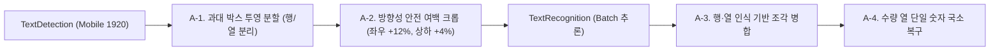

# OCR 개선안 반영 상세 튜닝 설계서 (v1)

작성일: 2026-11-18 · 대상 프로젝트: `D:\ssafy\ocr\mogumogu`  
선행 분석 문서: [OCR_실험측정_문제점_및_개선안_통합정리_20261118_v1.md](file:///D:/ssafy/ocr/mogumogu/full_receipt_20261117/OCR_실험측정_문제점_및_개선안_통합정리_20261118_v1.md)

본 문서는 KORIE 1·2차 인식기 파인튜닝 및 스마트폰 영수증(304장, 8,343줄) 진단 실험에서 규명된 4대 병목(**① 검출·영역 분할·매칭 오류 전파, ② 인식기 고정 폭 `320px`·길이 `25자` 제한, ③ 영수증 조판 공백·특수기호 불일치, ④ 평가 매칭 및 부분 GT 한계**)을 해결하기 위한 **코드·설정·알고리즘 수준의 상세 튜닝 설계서**다.

---

## 1. 설계 목표 및 단계별 목표 지표 (Target KPIs)

### 1.1 핵심 설계 원칙
1. **원본 및 기존 산출물 불변 보존**: 기존 데이터셋, 1·2차 체크포인트(`round2/run_001`), 기존 평가 폴더는 읽기 전용으로 유지하며 모든 신규 코드는 새 버전 경로(`region_improvement_v2/`, `round3/run_001/`, `postprocess_v1/`)에 기록한다.
2. **단계별 독립 검증 (Ablation Isolation)**: 후처리 정규화(Track C) → 영역 처리 개선(Track A) → 인식기 3차 학습(Track B)을 한 번에 섞지 않고 단계별로 누적 측정하여 각 기법의 순수 기여도와 역전(Regression) 건수를 분리 기록한다.
3. **추론 지연시간 예산 준수**: RTX 5070 Ti 기준 장당 평균 전체 OCR 시간을 **0.45초 이내**(Mobile 검출기 유지)로 제한한다.
4. **이중 채점(Dual-Scoring) 유지**: 기존 `Strict 1:1 IoU ≥ 0.5 + 공백 보존 NFC` 지표를 주 비교 기준선으로 반드시 유지하면서, `정규화 후 지표`와 `다대일(Line-grouped) 매칭 지표`를 병행 산출한다.

### 1.2 단계별 정량 목표 지표

| 평가 대상 및 지표 | 현재 기준선 (2차 모델 + Mobile 조정) | Track C 적용 후 (공백·문맥 후처리) | Track A 적용 후 (패딩·투영 분할·병합) | Track B 적용 후 (3차 인식기: 폭 640·길이 60) |
|---|---:|---:|---:|---:|
| **KORIE Val Crop 전체 CER** (1,785개, 보류 92개 포함) | 23.35% | 22.5% 이하 | 해당 없음 (Crop) | **14.5% 이하** |
| **KORIE Val 길이 보류(92개) CER** | 75.34% | 74.0% 이하 | 해당 없음 (Crop) | **25.0% 이하** |
| **스마트폰 정답 Crop CER / EM** (8,343줄) | 8.18% / 59.49% | **5.8% / 69.0%+** | 해당 없음 (Crop) | **4.8% / 73.0%+** |
| **스마트폰 정답 Crop 25자 초과 EM** (440줄) | 15.00% | 20.0%+ | 해당 없음 (Crop) | **45.0%+** |
| **스마트폰 부분 GT 전체 CER** (8,343줄, 1:1 매칭) | 20.52% | 18.0% 이하 | **15.0% 이하** | **13.0% 이하** |
| **스마트폰 부분 GT 미매칭 줄 수** (`missing_gt`) | 983~984줄 | 983줄 | **650줄 이하** | **650줄 이하** |
| **스마트폰 경계 민감 오답** (`crop_exact_full_incorrect`) | 624줄 (복구 후 328줄 잔존) | 260줄 이하 | **180줄 이하** | **130줄 이하** |
| **전체 OCR 장당 평균 처리 시간** (RTX 5070 Ti) | 0.405초 | ≤ 0.410초 | ≤ 0.430초 | ≤ 0.450초 |

---

## 2. Track A: 검출 영역 처리 및 레이아웃 재구성 설계 (`receipt_regions_v2.py`)

현재 [receipt_regions_v1.py](file:///D:/ssafy/ocr/mogumogu/full_receipt_20261117/region_improvement_20261118_v1/receipt_regions_v1.py)의 한계는 ① 폴리곤 크롭 시 여백이 전혀 없어 글자 끝이 잘리고, ② 과대 박스(494줄)를 쪼개는 로직이 없으며, ③ 조각 연결이 열(Column) 경계를 무시해 과병합(신규 미매칭 227줄)을 유발한다는 점이다. 이를 아래와 같이 4단계 파이프라인으로 재설계한다.



### A-1. 과대 병합 박스(Over-merged Box, 494줄) 투영 분할기 설계

검출기가 출력한 폴리곤 중 상하 여러 줄이 붙거나 좌우 다른 열(예: 상품명과 금액)이 하나로 합쳐진 박스를 인식 전에 분할한다.

1. **영수증 기준 행 높이($H_{\text{med}}$) 추정**:
   - 한 영수증 내 전체 검출 박스들의 높이 $h_i = y_{\max,i} - y_{\min,i}$ 중 하위 15%~상위 85% 구간의 중앙값(median)을 $H_{\text{med}}$로 정의한다.
2. **수평 투영(Horizontal Projection) 기반 다중 행(Multi-row) 분할**:
   - **트리거 조건**: 박스 높이 $h_i \ge 1.65 \times H_{\text{med}}$ 이고 종횡비 $w_i / h_i \ge 1.2$ 인 박스.
   - **분할 알고리즘**:
     1. 해당 영역을 그레이스케일로 변환 후 적응형 이진화(`cv2.adaptiveThreshold` 또는 Otsu)하여 글자 픽셀(어두운 픽셀)을 `1`, 배경을 `0`으로 만든다.
     2. 각 행 $y \in [0, h_i)$의 글자 픽셀 밀도 $P_y = \frac{1}{w_i}\sum_{x=0}^{w_i-1} B(y, x)$를 계산하고, 크기 3의 이동평균으로 스무딩한다.
     3. 박스 상하단 20% 가장자리를 제외한 내부 구간 $y \in [0.2 h_i, 0.8 h_i]$에서 $P_y < 0.05$인 골짜기(valley) 구간을 탐색한다.
     4. 골짜기로 나뉜 각 서브 박스의 높이가 모두 $0.65 \times H_{\text{med}}$ 이상이면 해당 $y^*$ 좌표를 기준으로 폴리곤을 상/하 분할한다.
3. **수직 투영(Vertical Projection) 기반 다중 열(Multi-column) 과대 박스 분할**:
   - **트리거 조건**: 단일 행 높이($h_i < 1.65 \times H_{\text{med}}$)이면서 박스 폭이 영수증 전체 텍스트 폭($W_{\text{receipt}}$)의 `45%` 이상($w_i \ge 0.45 \times W_{\text{receipt}}$)인 박스.
   - **분할 알고리즘**:
     1. 각 열 $x \in [0, w_i)$의 수직 글자 픽셀 밀도 $V_x = \frac{1}{h_i}\sum_{y=0}^{h_i-1} B(y, x)$를 계산한다.
     2. 연속된 빈 배경 구간($V_x < 0.02$)의 길이 $\Delta x$가 **$\Delta x \ge 1.8 \times h_i$** 이상이면(일반 띄어쓰기 간격은 $0.3\sim0.8 h_i$, 열 간격은 $1.8 h_i$ 이상), 해당 빈 구간의 양 끝점에 맞춰 좌/우 타이트한 서브 박스로 분리한다(가운데 빈 배경 구간은 버림으로써 정답 박스와의 IoU를 대폭 끌어올림).

### A-2. 방향성 안전 여백 크롭 (`crop_quad_padded`) 설계

기존 [`crop_quad`](file:///D:/ssafy/ocr/mogumogu/full_receipt_20261117/region_improvement_20261118_v1/receipt_regions_v1.py#L15-L25)는 꼭짓점 그대로 원근 변환하여 첫 글자(`부 가 세` → `가 세`, `[구 매]` → `[구 ]`)나 끝 괄호·숫자가 잘리는 현상(413줄)을 일으킨다. 검출 박스 좌표 자체(매칭용 `bbox`)는 변경하지 않고, **인식기에 넣는 이미지 패치(`crop`)를 만들 때만 폴리곤을 비대칭 확장**한다.

- **확장 수식**:
  - 상단 변 방향 단위벡터 $\vec{u}_{\text{top}} = \frac{P_1 - P_0}{\|P_1 - P_0\|}$, 하단 변 방향 단위벡터 $\vec{u}_{\text{bot}} = \frac{P_2 - P_3}{\|P_2 - P_3\|}$
  - 좌측 변 방향 단위벡터 $\vec{v}_{\text{left}} = \frac{P_3 - P_0}{\|P_3 - P_0\|}$, 우측 변 방향 단위벡터 $\vec{v}_{\text{right}} = \frac{P_2 - P_1}{\|P_2 - P_1\|}$
  - 좌우 여백 길이 $\delta_x = \min(\max(0.12 \times h, 4.0\text{px}), 16.0\text{px})$
  - 상하 여백 길이 $\delta_y = \min(\max(0.04 \times h, 2.0\text{px}), 6.0\text{px})$
  - 확장된 꼭짓점 $P'_0, P'_1, P'_2, P'_3$를 이미지 경계 $[0, W-1] \times [0, H-1]$ 내로 클리핑한 후 `cv2.warpPerspective`를 수행한다.
- **효과**: 검출 박스의 IoU 점수는 전혀 깎지 않으면서 인식기가 첫/끝 글자의 컨텍스트를 온전히 볼 수 있게 한다.

### A-3. 행·열(Row-Column) 구조 기반 조각 병합기 (`merge_fragments_v2`) 설계

기존 [`merge_fragments`](file:///D:/ssafy/ocr/mogumogu/full_receipt_20261117/region_improvement_20261118_v1/receipt_regions_v1.py#L29-L50)가 만든 227줄의 신규 미매칭을 막기 위해 **영수증 열 경계 보호 규칙**을 도입한다.

1. **영수증 가로 정규화 좌표계($\hat{x} \in [0, 1]$) 산출**:
   - 영수증 내 전체 박스의 최소 $x_{\min}$을 $X_L$, 최대 $x_{\max}$를 $X_R$로 두고 $\hat{x} = (x - X_L) / \max(X_R - X_L, 1)$로 정규화한다.
2. **허용 병합 조건 (Strict Column-aware Merge)**:
   - 수직 겹침률 `vy >= 0.70`, 높이 비율 `ratio <= 1.5`.
   - **케이스 1 (동일 열 내 깨진 글자·단어 조각 연결)**:
     - 두 박스 간 거리 `gap <= 0.45 * h` 이고, 두 박스 모두 숫자 단독 열(단가·수량·금액 열, $\hat{x} > 0.55$의 순수 숫자/콤마 문자열)이 아닐 때 병합.
     - 단, 좌측 박스가 한글 상품명이고 우측 박스가 3자리 이상 금액 패턴(`\d{1,3}(,\d{3})+`)이면 열이 다르므로 `gap`이 작더라도 **병합 금지**.
   - **케이스 2 (바코드 + 금액 행 연결)**:
     - 좌측이 12~13자리 바코드 숫자(`^\d{12,13}$`)이고 우측이 금액 패턴(`^[\d,]+$`)이며 같은 행에 다른 박스가 없을 때만 병합하되, **병합 전 원본 개별 박스(`raw_detections`)도 보조 후보로 유지**한다.

### A-4. 수량 열 한 글자 숫자(`1`, `2`) 국소 복구기 설계

- **대상 문제**: `little_or_no_detection` 144줄 중 다수를 차지하는 수량 열의 한 글자 숫자(`1`, `2`, `3`) 누락 ([analysis.json](file:///D:/ssafy/ocr/mogumogu/full_receipt_20261117/phone_baseline/analysis_v2/analysis.json#L218-L253)).
- **알고리즘**:
  1. 동일 행(Y축 중심 차이 `< 0.5 * H_med`)에 ‘단가(또는 바코드/상품명)’ 박스와 우측 끝 ‘금액’ 박스가 존재할 때, 두 박스 사이의 수평 공백 구간 $[x_{\text{left\_end}}, x_{\text{right\_start}}]$을 확인한다.
  2. 이 구간의 폭이 $2.5 \times H_{\text{med}}$ 이상이고 내부에 검출된 박스가 하나도 없다면, 해당 구간의 이진화 이미지에서 면적 $A \in [0.08 H_{\text{med}}^2, 0.8 H_{\text{med}}^2]$인 연결 요소(Connected Component)를 탐색한다.
  3. 연결 요소가 존재하면 해당 중심 주변을 $1.2 H_{\text{med}} \times 1.2 H_{\text{med}}$로 크롭해 인식기에 넣는다.
  4. 예측 문자열이 `1~9`의 1~2자리 숫자이고 `rec_score >= 0.82`일 때만 유효 검출 박스로 추가한다(오검출 방지).

---

## 3. Track B: 인식기(Recognition) 3차 파인튜닝 상세 설계 (`train_round3.py`)

### B-1. 장문(`> 25자`) 및 고정 폭(`320px`) 병목 해소를 위한 모델·입력 변경

현재 [train.yml](file:///D:/ssafy/ocr/mogumogu/full_receipt_20261117/round2/run_001/train.yml)은 `max_text_length: 25`, `image_shape: [3, 48, 320]`으로 고정되어 있어 KORIE validation에서 92개(오류의 56.7%), 스마트폰에서 440줄(EM 15.0%)의 장문 인식이 무너진다.

1. **입력 폭 및 최대 텍스트 길이 확장**:
   - `Global.max_text_length`: `25` → **`60`** (KORIE train/val/test의 p99 길이 49자를 여유 있게 수용하며, 길이 보류 표본을 train 263개 → 6개 이하, val 92개 → 2개 이하로 97% 이상 해소).
   - `Global.d2s_train_image_shape`: `[3, 48, 320]` → **`[3, 48, 640]`** (KORIE p95 폭 531.6px 수용).
   - `Train.sampler.scales`: `[[320, 32], [320, 48], [320, 64]]` → **`[[640, 32], [640, 48], [640, 64]]`**.
   - `Train.dataset.transforms[1].RecConAug`: `image_shape: [48, 640, 3]`, `max_text_length: 60`.
   - `Eval.dataset.transforms[2].RecResizeImg.image_shape`: `[3, 48, 320]` → **`[3, 48, 640]`**.
2. **가중치 호환성 및 `MultiHead`(`CTCHead` + `NRTRHead`) 처리 설계**:
   - `PPLCNetV3` 백본과 `SVTR` 넥, `CTCHead`는 입력 이미지 폭($W=320 \to 640$)이나 `max_text_length`(`25 -> 60`)가 바뀌어도 **가중치 텐서 shape이 100% 동일**하다(시간축 시퀀스 길이 $T = W / 8$만 40에서 80으로 늘어날 뿐 컨볼루션·어텐션·선형 레이어 차원은 불변).
   - 반면 학습 보조 헤드인 `NRTRHead`는 `max_text_length`가 바뀌면 내부 위치 임베딩(positional embedding) 또는 디코더 마스크 길이가 `max_text_length`에 의존할 수 있다.
   - **안전한 설계**:
     - `Architecture.Head.head_list[1].NRTRHead.max_text_length`를 `60`으로 설정한 뒤 `smoke` 단계에서 `not matched` 경고가 발생하는지 자동 검사한다([train_round2.py](file:///D:/ssafy/ocr/mogumogu/full_receipt_20261117/train_round2.py#L83-L85) 검증 로직 동일 적용).
     - 만약 `NRTRHead` 내부 버퍼가 길이 25에 고정되어 있다면, ① 2차 best 가중치 로드 시 `NRTRHead`의 길이 관련 버퍼만 슬라이스/보간(interpolation)하여 이식하는 유틸리티(`upgrade_checkpoint_max_len.py`)를 거치거나, ② 추론 시에는 어차피 `CTCHead`만 export되므로 `NRTRHead`의 max_text_length는 `60`으로 재초기화 후 `CTCHead`+`Backbone` 가중치를 100% 로드한다.
3. **[training/korie.py](file:///D:/ssafy/ocr/mogumogu/training/korie.py#L174-L175) 설정 생성 가드 확장**:
   - 기존 `korie.py config`의 `if report['max_text_length'] != cfg['Global']['max_text_length']: raise ValueError(...)` 가드를 수정하여, `--max-length 60` 및 `--max-width 640` 인자가 명시적으로 주어졌을 때 `Global.max_text_length`, `NRTRHead.max_text_length`, `RecConAug`, `MultiScaleSampler`, `RecResizeImg`를 일관되게 `60` 및 `640`으로 동기화하도록 확장한다.

### B-2. 검출 박스 흔들림 대응을 위한 데이터 증강 (Box Jittering & Short-Crop Padding)

1. **On-the-fly Bounding Box Jittering 증강 (신규 추가)**:
   - 스마트폰에서 정답 crop은 맞지만 검출 crop에서 틀리는 413줄을 해결하기 위해, 학습 시 crop 이미지의 상하좌우 가장자리를 미세하게 잘라내거나(clipping simulation, 최대 `4%`) 복제 여백을 덧붙이는(over-padding simulation, 최대 `12%`) 변환을 확률 `0.5`로 적용한다.
2. **`RecConAug` 확률 조정 (`0.5 → 0.35`)**:
   - `RecConAug`는 짧은 crop 여러 개를 가로로 이어붙여 긴 줄을 합성하므로 장문 인식에는 유리하지만, 과도하면 한 글자 숫자(`1`, `2`)나 2~3글자 단문(`금액`, `부가세`)을 단독으로 보는 빈도가 줄어든다. 따라서 확률을 `0.35`로 낮추어 단문 단독 학습 비중을 `65%`로 확보한다.

### B-3. 문자 사전(Dictionary) 처리 전략 (Round 3-A vs Round 3-B 2단계 분리)

사전 변경은 출력 FC 레이어(`CTCHead.fc.weight`: `[120, 11947]`, `NRTRHead.tgt_word_prj.weight`)의 차원을 바꾸므로 실험을 엄격히 2단계로 분리한다.

- **Round 3-A (사전 불변, 주력 모델)**:
  - 기존 `ppocrv5_korean_dict.txt`(11,945자, 해시 `2193f5dd...`)를 그대로 유지한다.
  - 2차 최고 체크포인트(`round2/run_001/outputs_train/best_accuracy.pdparams`)의 백본·넥·헤드 가중치를 손실 없이 100% 이어받아 **입력 폭 640 + 최대 길이 60 + Box Jittering** 효과를 검증한다.
- **Round 3-B (영수증 빈출 OOV 10종 사전 확장 실험, 선택적 후속)**:
  - 스마트폰과 KORIE에서 공통으로 확인된 빈출 기호 10종(`♥`, `★`, `◆`, `₩`, `」`, `「`, `☎`, `♣`, `〕`, `〔`)을 사전 끝에 추가하여 `ppocrv5_korean_receipt_dict_v1.txt`(11,955자)를 생성한다.
  - 가중치 이식 스크립트로 기존 `[120, 11947]` 가중치를 `[120, 11957]` 텐서에 복사(새 기호 10개 인덱스만 Xavier 초기화, 마지막 space 인덱스는 맨 끝 `11956`번으로 이동 복사)하여 기존 한국어 인식 능력을 보존한 채 특수기호만 추가 학습한다.

### B-4. 3차 학습 YAML 설정 명세 (`round3/run_001/train.yml`)

2차 학습에서 epoch 5에 조기 수렴한 원인은 이미 1차 학습된 가중치에 `LR 1e-5`를 적용해 초기 업데이트가 컸기 때문이다. 3차 학습에서는 **폭 2배 확대(`320→640`)에 맞춰 배치 크기를 `16`으로 조정**하고, **학습률을 `5.0e-6`으로 낮추며, Warmup을 `2 epochs`, L2 정규화를 `5.0e-5`로 강화**한다.

```yaml
Global:
  model_name: korean_PP-OCRv5_mobile_rec
  debug: false
  use_gpu: true
  epoch_num: 20
  log_smooth_window: 20
  print_batch_step: 10
  save_model_dir: /workspace/full_receipt_20261117/round3/run_001/outputs_train
  save_epoch_step: 1
  eval_batch_step: [0, 50]
  cal_metric_during_train: true
  pretrained_model: /workspace/full_receipt_20261117/round2/run_001/outputs_train/best_accuracy.pdparams
  character_dict_path: /workspace/full_receipt_20261117/PaddleOCR/ppocr/utils/dict/ppocrv5_korean_dict.txt
  max_text_length: 60
  use_space_char: true
  d2s_train_image_shape: [3, 48, 640]
  seed: 42

Optimizer:
  name: Adam
  beta1: 0.9
  beta2: 0.999
  lr:
    name: Cosine
    learning_rate: 5.0e-06
    warmup_epoch: 2
  regularizer:
    name: L2
    factor: 5.0e-05

Architecture:
  model_type: rec
  algorithm: SVTR_LCNet
  Backbone:
    name: PPLCNetV3
    scale: 0.95
  Head:
    name: MultiHead
    head_list:
      - CTCHead:
          Neck:
            name: svtr
            dims: 120
            depth: 2
            hidden_dims: 120
            kernel_size: [1, 3]
            use_guide: true
          Head:
            fc_decay: 1.0e-05
      - NRTRHead:
          nrtr_dim: 384
          max_text_length: 60

Train:
  dataset:
    name: MultiScaleDataSet
    ds_width: false
    data_dir: /workspace/full_receipt_20261117/data/ocr
    ext_op_transform_idx: 1
    label_file_list:
      - /workspace/full_receipt_20261117/round3/run_001/data/train_list.txt
    transforms:
      - DecodeImage: {img_mode: BGR, channel_first: false}
      - RecConAug:
          prob: 0.35
          ext_data_num: 2
          image_shape: [48, 640, 3]
          max_text_length: 60
      - RecAug: null
      - MultiLabelEncode: {gtc_encode: NRTRLabelEncode}
      - KeepKeys:
          keep_keys: [image, label_ctc, label_gtc, length, valid_ratio]
  sampler:
    name: MultiScaleSampler
    scales: [[640, 32], [640, 48], [640, 64]]
    first_bs: 16
    fix_bs: false
    divided_factor: [8, 16]
    is_training: true
  loader:
    shuffle: true
    batch_size_per_card: 16
    drop_last: true
    num_workers: 4

Eval:
  dataset:
    name: SimpleDataSet
    data_dir: /workspace/full_receipt_20261117/data/ocr
    label_file_list:
      - /workspace/full_receipt_20261117/round3/run_001/data/val_list.txt
    transforms:
      - DecodeImage: {img_mode: BGR, channel_first: false}
      - MultiLabelEncode: {gtc_encode: NRTRLabelEncode}
      - RecResizeImg:
          image_shape: [3, 48, 640]
      - KeepKeys:
          keep_keys: [image, label_ctc, label_gtc, length, valid_ratio]
  loader:
    shuffle: false
    drop_last: false
    batch_size_per_card: 16
    num_workers: 2
```

> **추론 Export 후 검증 주의사항**: `tools/export_model.py` 실행 후 생성된 `export/inference.yml` 내부의 `PreProcess.transform_ops[1].RecResizeImg.image_shape`가 `[3, 48, 640]`으로 기록되었는지 반드시 자동 검증한다. 또한 1차/2차 모델(`320`)과 3차 모델(`640`)을 비교할 때 [training/korie.py](file:///D:/ssafy/ocr/mogumogu/training/korie.py#L245-L247)의 `if configs[0]['PreProcess'] != configs[1]['PreProcess']` 가드가 폭 변경을 허용하도록 `--allow-preprocess-resize-diff` 플래그를 추가한다.

---

## 4. Track C: 텍스트 정규화 및 영수증 문맥 후처리 설계 (`text_postprocess_v1.py`)

모델 재학습 없이 공백 불일치(928줄)와 숫자·기호 혼동을 즉시 줄이기 위한 결정론적(deterministic) 후처리 모듈이다.

### C-1. 이중 출력(Dual-Output) 인터페이스
모든 추론 결과 JSON은 원문 보존 채점용 필드와 정규화 필드를 분리하여 저장한다:
```json
{
  "rec_text_raw": "결 제 대 상 금 액",
  "rec_text_norm": "결제대상금액",
  "rec_text_nospace": "결제대상금액",
  "postprocess_applied": ["keyword_space_collapse"]
}
```

### C-2. 단계별 정규화 규칙 명세

1. **Step 1 — 유니코드 및 안전 호환 기호 정규화 (Selective Compatibility Mapping)**:
   - `unicodedata.normalize('NFC', text)` 적용 후, 원문자(`ⓔ`, `㉣`)의 의미를 바꾸지 않는 **안전 전각 기호 매핑 테이블**만 적용한다:
     - `＆` (`U+FF06`) → `&`, `：` (`U+FF1A`) → `:`, `／` (`U+FF0F`) → `/`, `，`(`U+FF0C`) → `,`, `（` → `(`, `）` → `)`, `［` → `[`, `］` → `]`, `～` → `~`.
   - 연속된 다중 공백(`r'\s{2,}'`)을 단일 ASCII 공백(`' '`)으로 축약하고 양 끝 공백(`strip()`)을 제거한다.
2. **Step 2 — 영수증 조판용 한글 자간 공백 결합 (Receipt Keyword Space Collapse)**:
   - 영수증 양식에서 글자 사이에 공백이 삽입되는 고정 키워드들을 정규식 사전으로 결합한다:
     - 대상 패턴: `상 품 명`, `단 가`, `수 량`, `금 액`, `부 가 세`, `과 세 물 품`, `면 세 물 품`, `결 제 대 상 금 액`, `받 은 금 액`, `청 구 금 액`, `합 계 금 액`, `신 용 카 드`, `현 금 영 수 증`, `사 업 자 번 호`, `대 표 이 사`, `가 맹 점 명`, `승 인 번 호`, `거 래 일 시` 등.
     - 정규식 예: `r'결\s*제\s*대\s*상\s*금\s*액'` → `'결제대상금액'`, `r'\(\*\)\s*면\s*세\s*물\s*품'` → `'(*)면세물품'`.
3. **Step 3 — 숫자·단위·구두점 문맥 오인식 교정**:
   - **숫자 뒤 영문 `O` → 숫자 `0` 교정**:
     - `r'(?<=\d)O(?=\d|[gG]|[mM][lL]|원|개|%|$)'` → `'0'` (예: `30Og` → `300g`).
   - **고정 영문 키워드 내 `0` → `O` 교정**:
     - `r'\bP0S(?=:|\s|\d)'` → `'POS'` (예: `P0S:7601-4959` → `POS:7601-4959`).
   - **금액 패턴 내 소수점 오인식(`.` → `,`) 교정**:
     - 한국 원화 금액에는 소수점 이하 3자리 표기가 없으므로, 날짜(`2024.10.04`)가 아닌 단독 금액 패턴 `r'(?<![\d.])([1-9]\d{0,2})\.(\d{3})(?![\d.])'`에서 `.`을 `,`로 교정 (예: `8.000 1` → `8,000 1`).
   - **수량 열 단독 기호 교정**:
     - 수량 열 위치($0.55 \le \hat{x} \le 0.80$)의 1글자 예측이 `]` 또는 `I` 또는 `l`이고 인접 행이 상품 행일 경우 `'1'`로 교정 ([analysis.json](file:///D:/ssafy/ocr/mogumogu/full_receipt_20261117/phone_baseline/analysis_v2/analysis.json#L888-L956)의 `r047_010`, `r124_012`, `r126_020` 사례).

### C-3. 영수증 산술 제약 검증기 (`verify_receipt_arithmetic`)
- 한 영수증 내의 품목 행들에 대해 `(단가, 수량, 금액)` 튜플을 파싱하여 $P_{\text{unit}} \times Q = P_{\text{total}}$ 성립 여부를 검사한다.
- 만약 $P_{\text{unit}}$과 $P_{\text{total}}$이 명확히 읽혔는데($P_{\text{total}} \pmod{P_{\text{unit}}} == 0$) 수량 $Q$만 누락되었거나 오인식된 경우, $Q^* = P_{\text{total}} / P_{\text{unit}}$ ($1 \le Q^* \le 99$)로 후보를 제안하고 `arithmetic_verified: true/false` 메타데이터를 기록한다.

---

## 5. Track D: 평가 체계 확장 및 데이터셋·Holdout 구축 설계

### D-1. 4종 다층 평가 지표(`metrics_v2.py`) 정의
기존 [metrics.py](file:///D:/ssafy/ocr/mogumogu/ocr_baseline/scripts/metrics.py)를 수정하지 않고, 이를 호출하여 확장 지표를 함께 계산하는 `metrics_v2.py`를 추가한다.

| 지표 ID | 매칭 방식 | 텍스트 전처리 | 목적 및 해석 |
|---|---|---|---|
| **M1 (Strict Baseline)** | 1:1 최대 매칭 (`IoU ≥ 0.5`) | NFC만 적용 (공백·구두점 보존) | 기존 모든 실험과의 **100% 하위 호환 비교 기준선** |
| **M2 (Normalized 1:1)** | 1:1 최대 매칭 (`IoU ≥ 0.5`) | Track C 정규화 적용 (GT/예측 동일 규칙) | 조판 공백·기호 표기 차이를 제거한 실질 문자열 정확도 |
| **M3 (Whitespace-Free 1:1)** | 1:1 최대 매칭 (`IoU ≥ 0.5`) | 모든 공백 제거 후 비교 | 순수 글자/숫자 인식 성능 측정 (`verified_audit.json` 기준 재현) |
| **M4 (Line-Grouped N:M)** | 정답 박스 내부 포함(`IoP ≥ 0.65` & 수직 겹침 `≥ 0.6`) 다대일 매칭 | 검출 조각들을 X좌표 순으로 이어붙인 후 비교 | 검출기가 한 줄을 2개로 쪼갰을 때 100% 삭제 오류로 왜곡되는 현상을 분리하여 **실제 영수증 정보 획득률** 측정 |

### D-2. 스마트폰 데이터셋 분할 및 검출기용 Ignore Mask 설계
1. **영수증 해시 그룹 기반 분할 (Data Leakage 차단)**:
   - 기존 304장은 이미 진단에 노출되었으므로 `Diagnostic-Dev (48장)` 및 `Diagnostic-Confirm (256장)`으로 명시한다.
   - 스마트폰 데이터를 인식기 3차 튜닝의 보조 학습 데이터(Round 3-C 도메인 적응)로 사용할 경우, 반드시 영수증 원본 이미지 해시 및 매장명 기준으로 층화 추출하여 학습/검증 간 동일 매장·동일 영수증 중복을 0건으로 강제한다.
   - 최종 배포 전 검증을 위해 기존 304장과 완전히 독립된 **신규 촬영 영수증 50~100장(`unseen_holdout_v1`)**을 별도 폴더에 격리한다.
2. **검출기 파인튜닝 대비 `Ignore Mask` 생성기 (`build_det_ignore_masks.py`)**:
   - 스마트폰 데이터는 검증된 8,343줄만 GT로 라벨링되어 있고, 나머지 미검증 1,732줄 및 기타 영수증 하단 문구(약 7,000~8,000개 박스)는 GT에 없다.
   - 향후 검출기를 파인튜닝할 때는:
     1. 미검증 1,732줄의 폴리곤과,
     2. 현재 Mobile+Server 검출기가 공통으로 검출(`box_thresh >= 0.5`)했으나 검증 GT와 겹치지 않는 영역을 **`is_ignore: true` (Don't Care 마스크)**로 지정한다.
     3. DBNet loss 계산 시 해당 마스크 영역의 gradient를 `0`으로 마스킹하여, 실제 글자가 있는 영역이 배경(Negative)으로 잘못 학습되는 현상을 원천 차단한다.

---

## 6. 실행 순서, 검증 게이트(Gate Criteria) 및 롤백 규칙

각 단계는 컨테이너(`/workspace/full_receipt_20261117`) 환경에서 순차적으로 실행하며, 앞 단계의 검증 게이트를 통과해야만 다음 단계 결과를 채택한다.

### Step 1: 텍스트 정규화 및 다층 평가기 검증 (Track C & D)
- **구현 파일**: `full_receipt_20261117/postprocess_v1/text_postprocess_v1.py`, `metrics_v2.py`
- **실행 내용**: 새로운 GPU 추론 없이 기존 저장된 예측 파일(`crops_diagnostic_v1/predictions.jsonl`, `region_improvement_20261118_v1/evaluation/predictions.jsonl`)에 대해 M1~M4 지표를 산출한다.
- **통과 게이트 (Gate 1)**:
  - M1(Strict) 점수가 기존 통합표(`8.1774%`, `20.5240%`)와 소수점 넷째 자리까지 100% 일치할 것.
  - M2(Normalized) 기준 정답 crop EM이 기존 `59.49%` 대비 **+6.0%p 이상 상승**하고, 숫자·기호 줄에서 정규화로 인한 정답→오답 역전(Regression)이 **0건**일 것.

### Step 2: 영역 처리 v2 파이프라인 검증 (Track A)
- **구현 파일**: `full_receipt_20261117/region_improvement_v2/receipt_regions_v2.py`
- **실행 내용**: 인식기 가중치(`10e0e6b6...`)와 Mobile 검출기 가중치를 고정한 채, 48장 개발 세트에서 ① `crop_quad_padded` 단독, ② `+ split_overmerged_boxes`, ③ `+ merge_fragments_v2`, ④ `+ recover_single_digit_quantities`의 4단계 Ablation을 실행하고, 통과한 조합만 나머지 256장에 적용한다.
- **통과 게이트 (Gate 2)**:
  - `crop_quad_padded` 적용 시 기존 `crop_exact_full_incorrect`(624줄) 중 경계 민감 오류(413줄)에서의 편집오류가 기존(`528자`) 대비 **20% 이상 추가 감소**할 것.
  - 과대 박스 분할 및 열 인식 병합 적용 후 전체 미매칭(`missing_gt`)이 기존 `984줄`에서 **750줄 이하**로 감소하고, 신규 미매칭이 기존(`227줄`)의 절반 이하(`≤ 110줄`)로 억제될 것.
  - 만약 특정 서브 모듈(예: 수량 단문 복구)이 정답→오답 역전을 순개선보다 많이 유발하면 해당 플래그를 즉시 비활성화(rollback)한다.

### Step 3: 인식기 3차 파인튜닝 — 폭 640·길이 60 확장 (Track B: Round 3-A)
- **구현 파일**: `full_receipt_20261117/train_round3.py` (`train_round2.py`를 확장하여 `--max-length 60 --max-width 640` 지원)
- **실행 순서 (Linux GPU 컨테이너 내부)**:
  ```bash
  P=/workspace
  R=$P/full_receipt_20261117/round3/run_001
  S=$P/full_receipt_20261117/PaddleOCR
  D=$P/full_receipt_20261117/data/ocr
  W=$P/full_receipt_20261117/round2/run_001/outputs_train/best_accuracy.pdparams
  E=$P/full_receipt_20261117/round2/run_001/validation

  python $P/full_receipt_20261117/train_round3.py prepare --run "$R" --repo "$S" --data-root "$D" --weights "$W" --pre-eval "$E" --max-length 60 --max-width 640
  python $P/full_receipt_20261117/train_round3.py smoke --run "$R" --repo "$S" --data-root "$D"
  python $P/full_receipt_20261117/train_round3.py train --run "$R" --repo "$S" --data-root "$D"
  python $P/full_receipt_20261117/train_round3.py export --run "$R" --repo "$S" --data-root "$D"
  python $P/full_receipt_20261117/train_round3.py validate --run "$R" --repo "$S" --data-root "$D"
  ```
- **통과 게이트 (Gate 3)**:
  - `prepare` 단계의 `validation_report.json`에서 KORIE validation 보류 표본이 기존 `92개`에서 **5개 이하**로 줄어들 것.
  - `smoke` 단계에서 `loss: nan/inf` 없이 2 epoch 학습 및 체크포인트 저장이 통과할 것.
  - `validate` 단계에서 KORIE 전체 validation(1,785개) CER이 2차 모델(`23.35%`) 대비 **16.0% 이하**로 대폭 감소하고, 기존 25자 이하 표본(1,693개)에서도 CER 악화가 없을 것(`≤ 12.26%`).
  - 스마트폰 정답 crop(8,343줄) 평가에서 25자 초과 구간(440줄) EM이 기존 `15.00%`에서 **35.0% 이상**으로 상승하고 전체 CER이 `8.18%` 이하일 것.

### Step 4: 통합 파이프라인 결합 평가 및 최종 동결 (`freeze` & `test`)
- **실행 내용**: Gate 2를 통과한 `receipt_regions_v2.py`와 Gate 3을 통과한 3차 인식기(`round3/run_001/export`), 그리고 Gate 1을 통과한 `text_postprocess_v1.py`를 결합하여 스마트폰 304장 및 KORIE validation 전체 영수증을 평가한다.
- **최종 채택 및 롤백 규칙**:
  - 모든 검증 게이트를 통과하면 `train_round3.py freeze` 후 KORIE `test`(1,786개)를 단 1회 실행한다.
  - 만약 3차 인식기가 장문(25자 초과)에서는 개선되나 단문(1~25자)에서 역전이 발생한다면, **추론 시 이미지 종횡비($w/h > 6.5$)에 따라 2차 인식기(단문 특화, 폭 320)와 3차 인식기(장문 특화, 폭 640)로 분기(Routing)하는 듀얼 리코그나이저 구조**를 대안으로 채택한다.

---

## 7. 산출물 디렉터리 구조 명세

```text
full_receipt_20261117/
├── OCR_실험측정_통합정리_20261118_v1.md                  # [보존] 기존 실험 측정 요약
├── OCR_실험측정_문제점_및_개선안_통합정리_20261118_v1.md  # [보존] 측정 결과 + 문제점 + 개선안 통합본
├── OCR_개선안반영_상세튜닝설계서_20261118_v1.md           # [현재 문서] 상세 튜닝 설계서
├── postprocess_v1/                                       # Track C & D: 정규화·산술검증·다층지표
│   ├── text_postprocess_v1.py
│   ├── metrics_v2.py
│   ├── test_postprocess_v1.py                            # 합성 단위 테스트
│   └── re_evaluation_summary.json
├── region_improvement_v2/                                # Track A: 패딩 크롭·투영 분할·열 인식 병합
│   ├── receipt_regions_v2.py
│   ├── test_regions_v2.py                                # 기하학·분할·병합 단위 테스트
│   ├── ablation_dev48.json
│   └── comparison_304.json
└── round3/                                               # Track B: 폭 640·길이 60 인식기 3차 튜닝
    ├── train_round3.py
    └── run_001/
        ├── data/validation_report.json
        ├── smoke.yml
        ├── train.yml
        ├── outputs_train/
        ├── export/
        ├── validation/summary.json
        └── final_test/summary.json
```
